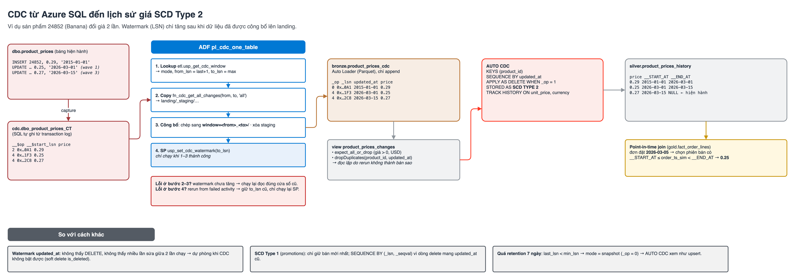

# 03 · Tầng silver: CDC → SCD, kiểm chất lượng, chuẩn hóa (bronze → silver)

**Đầu vào:**
- Bronze đã đạt đối soát ([02](02_bronze_ldp.md)).
- Phần stream (`silver.stream_orders`, `silver.stream_order_items`) do pipeline `instacart_stream` tạo ([04](04_streaming.md)).

**Đầu ra** (schema `silver`):

| Bảng | Kiểu | Kỹ thuật |
|---|---|---|
| `product_prices_history` | Streaming table | `AUTO CDC` → **SCD Type 2** |
| `promotions` | Streaming table | `AUTO CDC` → **SCD Type 1**, áp dụng delete |
| `order_time_sim` | Materialized view | Tính `order_ts_sim` tất định |
| `orders_batch` | Materialized view | Loại trùng, gắn thời gian |
| `order_items_prior` | Streaming table | `AUTO CDC` SCD1 theo khóa (`order_id`, `product_id`) |
| `quarantine_*` | Streaming table | Bản ghi vi phạm luật, kèm lý do |
| `off_products_clean`, `product_off_match` | Materialized view | Làm phẳng JSON, fuzzy match |
| `dim_product` | Materialized view | Danh mục đã làm giàu |
| `orders`, `order_items` | **View** UC | Gộp batch ∪ stream |
| `baskets` | Materialized view | Đầu vào DS |

**Xong khi:** đạt checklist G3 ở mục 9. Sau đó chạy job `ds-prepare` ([08](08_du_lieu_cho_ds.md)) rồi **DS bắt đầu**.

---

## 1. Ba loại bảng của LDP và khi nào dùng

| Loại | Dữ liệu được xử lý | Chạy lại | Dùng cho |
|---|---|---|---|
| **Streaming table** (`@dp.table` trả `readStream`, hoặc `create_streaming_table` + flow) | Chỉ dữ liệu **mới** kể từ lần trước (có checkpoint) | Dòng cũ không bị xử lý lại | Nguồn lớn và chỉ tăng; đích của `AUTO CDC` |
| **Materialized view** (`@dp.materialized_view`) | Kết quả của câu truy vấn trên **toàn bộ** nguồn | Tính lại. Trên classic là tính lại toàn bộ; serverless có thể tính tăng dần | Join, window, tổng hợp, bảng nhỏ và vừa |
| **View** tạm (`@dp.view`) | Không lưu, chỉ là bước trung gian trong pipeline | — | Nguồn của `AUTO CDC`, nơi đặt expectations |

## 2. CDC → SCD Type 2: lịch sử giá

### 2.1 SCD Type 1 và Type 2

Lấy ví dụ sản phẩm 24852 (Banana), đổi giá hai lần:

```
Luồng CDC (bronze.product_prices_cdc):
  _op=0  product_id=24852  unit_price=0.29  updated_at=2015-01-01   (snapshot)
  _op=4  product_id=24852  unit_price=0.25  updated_at=2026-03-01   (wave 1)
  _op=4  product_id=24852  unit_price=0.27  updated_at=2026-03-15   (wave 3)

SCD Type 1 → chỉ giữ giá mới nhất:
  product_id=24852  unit_price=0.27

SCD Type 2 → giữ mọi phiên bản, có khoảng hiệu lực:
  product_id  unit_price  __START_AT   __END_AT
  24852       0.29        2015-01-01   2026-03-01
  24852       0.25        2026-03-01   2026-03-15
  24852       0.27        2026-03-15   NULL          ← phiên bản hiện hành
```

SCD2 trả lời được câu hỏi "**đơn đặt ngày 05/03 trả giá bao nhiêu**": tìm phiên bản có `__START_AT ≤ order_ts_sim < __END_AT`.



<sub>File gốc: [diagrams/de_diagrams.drawio](diagrams/de_diagrams.drawio), trang 2.</sub>

### 2.2 Code

```python
# src/pipelines/batch/silver_retail.py
from pyspark import pipelines as dp
from pyspark.sql import functions as F

CAT    = spark.conf.get("catalog")
BRONZE = f"{CAT}.{spark.conf.get('bronze')}"
SILVER = f"{CAT}.{spark.conf.get('silver')}"

PRICE_RULES = {
    "price_positive":  "unit_price > 0",
    "currency_usd":    "currency = 'USD'",
    "has_product_id":  "product_id IS NOT NULL",
}


@dp.view(comment="Thay đổi giá đã loại trùng; nguồn của AUTO CDC")
@dp.expect_all_or_drop(PRICE_RULES)          # dòng vi phạm bị bỏ, số lượng ghi vào event log
def product_prices_changes():
    return (spark.readStream.table(f"{BRONZE}.product_prices_cdc")
            .select("product_id", "unit_price", "currency", "updated_at",
                    F.col("_op").cast("int").alias("_op"), "_lsn", "_seqval")
            # Cùng một thay đổi có thể được đọc 2 lần (rerun cả pipeline ADF, hoặc snapshot lại).
            # Khóa (product_id, updated_at) xác định duy nhất một lần đổi giá.
            .dropDuplicates(["product_id", "updated_at"]))


dp.create_streaming_table(
    name=f"{SILVER}.product_prices_history",
    comment="SCD2: lịch sử giá, mỗi phiên bản có __START_AT/__END_AT",
    table_properties={"delta.enableChangeDataFeed": "true"})

dp.create_auto_cdc_flow(
    target=f"{SILVER}.product_prices_history",
    source="product_prices_changes",
    keys=["product_id"],
    sequence_by=F.col("updated_at"),               # thời gian nghiệp vụ → __START_AT có nghĩa
    apply_as_deletes=F.expr("_op = 1"),
    except_column_list=["_op", "_lsn", "_seqval"],
    stored_as_scd_type=2,
    track_history_column_list=["unit_price", "currency"],   # đổi cột khác không sinh phiên bản mới
)
```

Bản SQL tương đương, viết vào báo cáo cho dễ đọc:

```sql
CREATE OR REFRESH STREAMING TABLE product_prices_history;

CREATE FLOW prices_scd2 AS AUTO CDC INTO product_prices_history
FROM stream(product_prices_changes)
KEYS (product_id)
APPLY AS DELETE WHEN _op = 1
SEQUENCE BY updated_at
COLUMNS * EXCEPT (_op, _lsn, _seqval)
STORED AS SCD TYPE 2
TRACK HISTORY ON unit_price, currency;
```

**`AUTO CDC` lo những việc mà viết MERGE tay dễ sai:**
- **Dữ liệu đến sai thứ tự:** thay đổi của wave 3 đến trước wave 2 vẫn được xếp đúng nhờ `SEQUENCE BY`.
- **Đóng phiên bản cũ:** gán `__END_AT` cho phiên bản cũ và mở phiên bản mới trong cùng một giao dịch.
- **Idempotent:** áp dụng lại cùng một thay đổi (cùng khóa, cùng `SEQUENCE BY`) không tạo phiên bản mới.

**Vì sao `SEQUENCE BY updated_at` mà không dùng `_lsn`:**
- Cả hai đều đúng thứ tự.
- Nhưng `__START_AT` / `__END_AT` lấy giá trị từ cột sequence. Dùng `updated_at` thì khoảng hiệu lực là **ngày giả lập**, join được với `order_ts_sim`. Dùng LSN thì chỉ ra một chuỗi hex.
- Điều kiện để dùng được: mỗi sản phẩm không đổi giá hai lần trong cùng một `updated_at`. Script seed đảm bảo điều này.

### 2.3 Promotions: SCD Type 1 có xóa

```python
@dp.view
@dp.expect_all_or_drop({
    "discount_range": "discount_pct BETWEEN 0 AND 90",
    "valid_window":   "end_date >= start_date",
})
def promotions_changes():
    return (spark.readStream.table(f"{BRONZE}.promotions_cdc")
            .select("promo_id", "product_id", "promo_type", "discount_pct", "start_date", "end_date",
                    "updated_at", F.col("_op").cast("int").alias("_op"), "_lsn", "_seqval")
            .dropDuplicates(["promo_id", "_lsn", "_seqval", "_op"]))


dp.create_streaming_table(name=f"{SILVER}.promotions",
                          comment="SCD1: khuyến mãi hiện hành; khuyến mãi bị hủy (delete ở nguồn) bị xóa")

dp.create_auto_cdc_flow(
    target=f"{SILVER}.promotions",
    source="promotions_changes",
    keys=["promo_id"],
    sequence_by=F.struct("_lsn", "_seqval"),       # thứ tự log tuyệt đối, kể cả delete
    apply_as_deletes=F.expr("_op = 1"),
    except_column_list=["_op", "_lsn", "_seqval"],
    stored_as_scd_type=1,
)
```

Ở đây **phải** dùng LSN: một dòng delete mang `updated_at` của lần sửa cuối, trùng với dòng update trước nó. Chỉ `(_lsn, _seqval)` mới xếp được delete đứng sau.

### 2.4 Kiểm tra SCD

```sql
-- 3 phiên bản của Banana, chỉ 1 phiên bản đang mở
SELECT product_id, unit_price, __START_AT, __END_AT
FROM instacart.silver.product_prices_history WHERE product_id = 24852 ORDER BY __START_AT;

-- Không sản phẩm nào có > 1 phiên bản đang mở
SELECT product_id, count(*) FROM instacart.silver.product_prices_history
WHERE __END_AT IS NULL GROUP BY 1 HAVING count(*) > 1;              -- 0 dòng

-- Khuyến mãi bị xóa ở nguồn không còn ở silver
SELECT count(*) FROM instacart.silver.promotions p
JOIN (SELECT promo_id FROM instacart.bronze.promotions_cdc WHERE _op = 1) d USING (promo_id);   -- 0
```

## 3. Đơn hàng và thời gian giả lập

### 3.1 `order_ts_sim` tất định

Instacart không có ngày tháng ([data_dictionary §4](../data/data_dictionary.md)). Cách tính:
- Đơn cuối của mỗi khách (đơn train hoặc test) rơi vào ngày `2026-03-01 + (user_id × 7919 mod 30)`.
- Các đơn trước được tính lùi bằng tổng `days_since_prior_order` của các đơn sau nó.

Công thức chỉ dùng phép số nguyên. Simulator Python tính lại **ra đúng cùng giá trị** ([04 §2](04_streaming.md)); test `tests/test_sim_time.py` so khớp hai bản.
AD-DE-02 đặt mốc `SIM_END_ANCHOR`, hàm `order_ts_sim` và truy vấn SQL ở
`src/common/sim_time.py`. Hàm Python trả `datetime` có múi giờ UTC; SQL dùng
`make_timestamp_ltz(..., 'UTC')` để cùng một thời điểm dù session đổi múi giờ hoặc kiểu timestamp mặc định.

```python
# src/pipelines/batch/silver_instacart.py  (đoạn đầu)
from pyspark import pipelines as dp
from pyspark.sql import functions as F

from common.sim_time import order_time_sim_sql

CAT    = spark.conf.get("catalog")
BRONZE = f"{CAT}.{spark.conf.get('bronze')}"
SILVER = f"{CAT}.{spark.conf.get('silver')}"


@dp.materialized_view(name=f"{SILVER}.order_time_sim",
                      comment="order_ts_sim tất định cho mọi đơn (prior/train/test)")
@dp.expect_or_fail("has_ts", "order_ts_sim IS NOT NULL")
def order_time_sim():
    return spark.sql(order_time_sim_sql(f"{BRONZE}.orders"))
```

Truy vấn dùng `row_number()` trong CTE rồi lọc `rn = 1`, chống trùng theo `order_id`
trước khi tính tổng ngày. Cách này chạy được trên Spark 3.5 local (không dùng `QUALIFY`).
Cast `order_number` sang INT để đơn 10 không đứng trước đơn 2 khi bronze chứa STRING;
cast `user_id` sang BIGINT trước phép nhân và `days_back` sang INT cho `date_sub`.
`days_since_prior_order` đi qua DOUBLE để nhận được cả chuỗi `"14.0"` ở ANSI mode.

Pipeline batch viết toàn bộ bằng Python. Chỗ nào SQL dễ đọc hơn thì dùng `spark.sql(f"""…""")` bên trong hàm, tên catalog/schema lấy từ `spark.conf`. Như vậy không phải lo cú pháp thay biến `${…}` của file SQL trong LDP.

### 3.2 `orders_batch` và `order_items_prior`

```python
# src/pipelines/batch/silver_instacart.py  (tiếp)
ORDER_RULES = {
    "valid_dow":   "order_dow BETWEEN 0 AND 6",
    "valid_hour":  "order_hour_of_day BETWEEN 0 AND 23",
    "valid_dsp":   "days_since_prior_order IS NULL OR days_since_prior_order BETWEEN 0 AND 30",
    "no_rescued":  "_rescued_data IS NULL",
}


@dp.materialized_view(name=f"{SILVER}.orders_batch",
                      comment="Header đơn prior/test từ batch; train đến từ stream",
                      cluster_by=["user_id"])
@dp.expect_all_or_drop(ORDER_RULES)
def orders_batch():
    o = (spark.read.table(f"{BRONZE}.orders")
         .where("eval_set IN ('prior', 'test')")
         .dropDuplicates(["order_id"]))
    t = spark.read.table(f"{SILVER}.order_time_sim").select("order_id", "order_ts_sim")
    return (o.join(t, "order_id", "left")
             .withColumn("source", F.lit("batch"))
             .withColumn("is_test", F.col("eval_set") == "test")
             .drop("_source_file", "_file_mtime"))


ITEM_RULES = {
    "has_keys":        "order_id IS NOT NULL AND product_id IS NOT NULL",
    "cart_order_pos":  "add_to_cart_order >= 1",
    "reordered_flag":  "reordered IN (0, 1)",
    "no_rescued":      "_rescued_data IS NULL",
}


@dp.view
@dp.expect_all_or_drop(ITEM_RULES)
def order_items_prior_src():
    return spark.readStream.table(f"{BRONZE}.order_products_prior")


dp.create_streaming_table(name=f"{SILVER}.order_items_prior", cluster_by=["order_id"])
dp.create_auto_cdc_flow(
    target=f"{SILVER}.order_items_prior",
    source="order_items_prior_src",
    keys=["order_id", "product_id"],           # mỗi sản phẩm một lần trong một đơn
    sequence_by=F.col("_ingest_ts"),
    except_column_list=["_rescued_data", "_source_file", "_file_mtime"],
    stored_as_scd_type=1,
)
```

**Vì sao `order_items_prior` dùng `AUTO CDC` thay vì append:**
- Nếu file prior phải nạp lại (đặt ở đường dẫn mới, xem [02 §5](02_bronze_ldp.md)), bronze sẽ có bản sao.
- Upsert theo khóa thì silver vẫn đúng 32.434.489 dòng.

**Cái giá:** lần nạp đầu là một MERGE 32 triệu dòng, khoảng 10–20 phút trên 4 vCPU. Đo lại và ghi vào `ops.benchmark_results`.

## 4. Kiểm chất lượng: expectations và quarantine

### 4.1 Ba mức phản ứng

| Decorator | Dòng vi phạm | Pipeline | Dùng khi |
|---|---|---|---|
| `@dp.expect(name, cond)` | **Giữ lại**, chỉ đếm | Chạy tiếp | Luật "nên đúng", ví dụ sản phẩm có ghép được OFF không |
| `@dp.expect_or_drop` | **Bỏ** khỏi bảng đích | Chạy tiếp | Dòng lỗi không dùng được, ví dụ giá âm |
| `@dp.expect_or_fail` | — | **Dừng** update, rollback flow đó | Lỗi nghiêm trọng, chạy tiếp sẽ hỏng dữ liệu, ví dụ `dim_product` bị nhân dòng |

Các bản `expect_all*` nhận một dict nhiều luật cùng lúc.

### 4.2 Không xóa im lặng: bảng quarantine

`expect_or_drop` chỉ **đếm** số dòng bị bỏ, không giữ lại nội dung. Để xem lại được dòng nào lỗi và vì sao, nhóm dùng **cùng bộ luật** cho một bảng quarantine với điều kiện **đảo ngược**:

```python
def quarantine(name: str, source: str, rules: dict):
    failed = F.filter(
        F.array(*[F.when(~F.expr(c), F.lit(k)) for k, c in rules.items()]),
        lambda x: x.isNotNull())

    @dp.table(name=f"{SILVER}.quarantine_{name}",
              comment=f"Dòng vi phạm luật của {source}; giữ để điều tra, không xóa")
    def _q():
        return (spark.readStream.table(source)
                .withColumn("_dq_failed", failed)
                .where(F.size("_dq_failed") > 0)
                .withColumn("_quarantined_at", F.current_timestamp()))


quarantine("order_items_prior", f"{BRONZE}.order_products_prior", ITEM_RULES)
quarantine("product_prices",    f"{BRONZE}.product_prices_cdc",   PRICE_RULES)
```

`~F.expr(c)` của một luật có giá trị NULL cũng ra NULL, nên dòng đó không bị coi là lỗi. Các luật ở trên đều viết sao cho không trả NULL; luật mới cũng phải theo nguyên tắc này.

Số liệu đạt/bị loại theo từng luật được lấy từ **event log** của pipeline và ghi vào `ops.dq_results` ([06 §3](06_van_hanh_chay_lai.md)). Power BI trang vận hành đọc bảng này.

## 5. Làm giàu từ Open Food Facts: làm phẳng JSON và fuzzy match

File này là **notebook** (định dạng `.py` có header `# Databricks notebook source`). Lý do: LDP cho phép `%pip install` ở ô đầu của notebook, còn file Python thuần thì không.

```python
# Databricks notebook source
# MAGIC %pip install rapidfuzz==3.*

# COMMAND ----------
# src/pipelines/batch/silver_off.py
import pandas as pd
from pyspark import pipelines as dp
from pyspark.sql import functions as F, types as T
from pyspark.sql.window import Window

from common.text import norm

CAT    = spark.conf.get("catalog")
BRONZE = f"{CAT}.{spark.conf.get('bronze')}"
SILVER = f"{CAT}.{spark.conf.get('silver')}"


@dp.materialized_view(name=f"{SILVER}.off_products_clean",
                      comment="OFF đã làm phẳng; mỗi (_product_id, code) một dòng mới nhất")
@dp.expect("has_name", "off_product_name IS NOT NULL")
def off_products_clean():
    return (spark.read.table(f"{BRONZE}.off_products")
            .select(
                F.col("_product_id").cast("int").alias("product_id"),
                F.col("code").alias("off_code"),
                F.col("product_name").alias("off_product_name"),
                F.concat_ws(",", "brands").alias("brand"),
                "categories_tags", "countries_tags", "nutriscore_grade", "nova_group",
                F.col("nutriments")["energy-kcal_100g"].cast("double").alias("energy_kcal_100g"),
                F.col("nutriments")["sugars_100g"].cast("double").alias("sugars_100g"),
                F.col("nutriments")["fat_100g"].cast("double").alias("fat_100g"),
                "image_url", "_ingest_ts")
            .withColumn("rn", F.row_number().over(
                Window.partitionBy("product_id", "off_code").orderBy(F.col("_ingest_ts").desc())))
            .where("rn = 1").drop("rn"))


@F.pandas_udf(T.DoubleType())
def match_score(ic_name: pd.Series, off_name: pd.Series, brand: pd.Series) -> pd.Series:
    from rapidfuzz import fuzz
    out = []
    for a, b, br in zip(ic_name, off_name, brand):
        s = fuzz.token_set_ratio(norm(a), norm(b))
        if br and norm(br.split(",")[0]) and norm(br.split(",")[0]) in norm(a):
            s += 5
        out.append(float(min(s, 100)))
    return pd.Series(out)


@dp.materialized_view(name=f"{SILVER}.product_off_match",
                      comment="Bảng cầu nối Instacart ↔ OFF: ứng viên tốt nhất mỗi product_id")
@dp.expect("has_score", "off_match_score IS NOT NULL")
def product_off_match():
    p = spark.read.table(f"{BRONZE}.products").select("product_id", "product_name").dropDuplicates(["product_id"])
    c = (spark.read.table(f"{SILVER}.off_products_clean")
         .where(F.array_contains("countries_tags", "en:united-states")))
    scored = (p.join(c, "product_id")
               .withColumn("off_match_score", match_score("product_name", "off_product_name", "brand")))
    w = Window.partitionBy("product_id").orderBy(F.col("off_match_score").desc(), "off_code")
    return (scored.withColumn("rn", F.row_number().over(w)).where("rn = 1")
            .withColumn("off_match_status",
                        F.when(F.col("off_match_score") >= 85, "matched")
                         .when(F.col("off_match_score") >= 70, "low_confidence")
                         .otherwise("no_match"))
            .select("product_id", "off_code", "off_match_score", "off_match_status"))
```

Hàm `norm` ở `src/common/text.py` có test (`tests/test_norm.py`) với 4 cặp tên ở
[data_dictionary §5.6](../data/data_dictionary.md). Notebook chỉ import lại hàm đó.
Hàm bỏ từ nhiễu/số đo trước khi bỏ dấu câu để `12.5 oz` không để lại `12`,
nhận đơn vị ghép `fl oz`, rồi chuẩn hóa khoảng trắng và cụm `bag-of`.
Đây là chuẩn hóa tên, chưa quyết định hai sản phẩm có khớp nhau; ngưỡng fuzzy vẫn áp dụng ở bước sau.

## 6. `dim_product`: join nhiều nguồn mà không nhân dòng

```python
@dp.materialized_view(name=f"{SILVER}.dim_product", cluster_by=["product_id"],
                      comment="products + aisle + department + giá hiện hành + KM đang chạy + OFF")
@dp.expect_or_fail("no_fanout", "dup_cnt = 1")          # LEFT JOIN không được nhân dòng
@dp.expect("has_price", "current_price IS NOT NULL")
def dim_product():
    as_of = F.to_date(F.lit(spark.conf.get("as_of_date", "2026-03-30")))
    p  = spark.read.table(f"{BRONZE}.products").dropDuplicates(["product_id"])
    a  = spark.read.table(f"{BRONZE}.aisles").dropDuplicates(["aisle_id"])
    d  = spark.read.table(f"{BRONZE}.departments").dropDuplicates(["department_id"])
    pr = (spark.read.table(f"{SILVER}.product_prices_history").where("__END_AT IS NULL")
          .select("product_id", F.col("unit_price").alias("current_price")))
    km = (spark.read.table(f"{SILVER}.promotions")
          .where((F.col("start_date") <= as_of) & (F.col("end_date") >= as_of))
          .groupBy("product_id").agg(F.max("discount_pct").alias("discount_pct")))   # gộp trước khi join
    m  = spark.read.table(f"{SILVER}.product_off_match").where("off_match_status = 'matched'")
    off = spark.read.table(f"{SILVER}.off_products_clean").drop("product_id", "_ingest_ts")
    img = spark.read.table(f"{BRONZE}.product_images").select("off_code", F.col("path").alias("image_path"))

    df = (p.join(a, "aisle_id", "left").join(d, "department_id", "left")
           .join(pr, "product_id", "left").join(km, "product_id", "left")
           .join(m.select("product_id", "off_code", "off_match_score", "off_match_status"), "product_id", "left")
           .join(off.dropDuplicates(["off_code"]), "off_code", "left")
           .join(img.dropDuplicates(["off_code"]), "off_code", "left")
           .withColumn("on_promotion", F.col("discount_pct").isNotNull()))
    # dup_cnt ở lại trong bảng để expectation kiểm được; Power BI không dùng cột này
    return df.withColumn("dup_cnt", F.count("*").over(Window.partitionBy("product_id")))
```

**Quy tắc chống nhân dòng:** mọi bảng bên phải của LEFT JOIN phải **duy nhất theo khóa join** trước khi join (`dropDuplicates`, `groupBy`, hoặc lọc `__END_AT IS NULL`). `expect_or_fail("no_fanout")` dừng pipeline nếu ai đó vô tình phá quy tắc này. Như vậy `dim_product` luôn đúng **49.688** dòng.

Đoạn này nằm trong `silver_off.py`, dùng chung import (`Window`, `F`) ở đầu notebook. `as_of_date` lấy từ `configuration` của pipeline, mặc định là ngày cuối cửa sổ replay.

## 7. Gộp batch ∪ stream và dựng `baskets`

Batch và stream thuộc **hai pipeline**, mà mỗi bảng chỉ có một pipeline chủ, nên chúng gặp nhau qua **view của Unity Catalog**. Task SQL `create_views` của job tạo view một lần; view không cần refresh.

```sql
-- src/tasks/create_views.sql
CREATE OR REPLACE VIEW instacart.silver.orders AS
SELECT order_id, user_id, eval_set, order_number, order_dow, order_hour_of_day,
       days_since_prior_order, order_ts_sim, source
FROM instacart.silver.orders_batch
UNION ALL
SELECT order_id, user_id, 'train', order_number, order_dow, order_hour_of_day,
       days_since_prior_order, event_time, 'stream'
FROM instacart.silver.stream_orders;

CREATE OR REPLACE VIEW instacart.silver.order_items AS
SELECT order_id, product_id, add_to_cart_order, reordered, 'batch' AS source
FROM instacart.silver.order_items_prior
UNION ALL
SELECT order_id, product_id, add_to_cart_order, reordered, 'stream'
FROM instacart.silver.stream_order_items;
```

`baskets` là materialized view trong pipeline batch. Nó đọc bảng của pipeline stream như một nguồn bên ngoài (được phép, vì chỉ **đọc**):

```python
# src/pipelines/batch/silver_instacart.py  (cuối file)
@dp.materialized_view(name=f"{SILVER}.baskets", cluster_by=["split"],
                      comment="Giỏ hàng cho DS: prior để train, holdout (đơn train qua stream) để đánh giá")
@dp.expect_or_fail("non_empty_basket", "n_items >= 1")
def baskets():
    return spark.sql(f"""
      SELECT order_id, user_id, split, array_sort(collect_set(product_id)) AS items, count(*) AS n_items
      FROM (
        SELECT i.order_id, o.user_id, i.product_id, 'prior' AS split
        FROM {SILVER}.order_items_prior i JOIN {SILVER}.orders_batch o USING (order_id)
        WHERE o.eval_set = 'prior'
        UNION ALL
        SELECT i.order_id, s.user_id, i.product_id, 'holdout'
        FROM {SILVER}.stream_order_items i JOIN {SILVER}.stream_orders s USING (order_id)
      )
      GROUP BY order_id, user_id, split""")
```

Đơn test không có món hàng nên tự nhiên không xuất hiện trong `baskets`.

## 8. Lỗi giữa chừng thì chạy lại thế nào

| Tình huống | Cách chạy lại | Vì sao không trùng, không mất |
|---|---|---|
| Update lỗi ở một flow `AUTO CDC` | Chạy lại update | Checkpoint chưa commit thì micro-batch được áp dụng lại. Upsert theo khóa + sequence nên kết quả như nhau |
| `expect_or_fail` dừng pipeline | Xem event log → sửa dữ liệu nguồn hoặc code → chạy lại | Flow lỗi rollback, các bảng khác giữ trạng thái cũ |
| Sửa logic một MV (ví dụ ngưỡng fuzzy) | Deploy → `refresh_selection` gồm MV đó và các bảng phía sau | MV luôn tính lại từ nguồn |
| Sửa logic SCD2 (ví dụ thêm cột theo dõi) | `full_refresh_selection = [product_prices_history]` | Bảng được dựng lại từ **toàn bộ** `bronze.product_prices_cdc`. Bronze không bị reset vì có `reset.allowed = false` |
| Silver sai do dữ liệu nguồn sai | Sửa nguồn (hoặc thêm luật quarantine) → `full_refresh_selection` các bảng silver liên quan. **Không** `RESTORE` / `UPDATE` tay bảng do pipeline quản lý ([06 §5](06_van_hanh_chay_lai.md)) | Silver dựng lại từ bronze còn đủ; time travel dùng để so trước/sau |

## 9. Checklist G3: silver đạt đối soát → DS bắt đầu

Chạy sau khi stream đã phát đủ ([04 §6](04_streaming.md)):

```sql
SELECT count(*) FROM instacart.silver.orders;                                   -- 3.421.083
SELECT source, count(DISTINCT order_id) FROM instacart.silver.orders GROUP BY 1; -- batch 3.289.874 | stream 131.209
SELECT count(*) FROM instacart.silver.order_items WHERE source = 'stream';      -- 1.384.617
SELECT count(*), count(DISTINCT order_id, product_id) FROM instacart.silver.order_items_prior;  -- 32.434.489 = nhau
SELECT count(*) FROM instacart.silver.dim_product;                              -- 49.688
SELECT split, count(*) FROM instacart.silver.baskets GROUP BY 1;                -- prior 3.214.874 | holdout 131.209
SELECT off_match_status, count(*) FROM instacart.silver.product_off_match GROUP BY 1;   -- ghi tỉ lệ khớp
```

Số đơn batch được tính bằng 3.421.083 − 131.209. Số giỏ `prior` được tính bằng 3.421.083 − 131.209 − 75.000. Cả hai phải kiểm lại bằng số thật của bản Zenodo.

- [ ] Các con số khớp, và `ops.reconciliation` ghi `passed = true` cho mọi bảng.
- [ ] `silver.quarantine_*` có số dòng giải thích được, đã ghi vào `ops.dq_results`.
- [ ] Chạy job `ds-prepare` để chụp `silver.baskets` thành `ds_data.baskets` (`data_version = 'v1'`) và dựng dữ liệu thực nghiệm cho DS ([08](08_du_lieu_cho_ds.md)). Không dùng `VERSION AS OF` trên `baskets`: đây là materialized view do pipeline quản lý, bản cố định phải là một bảng riêng.
